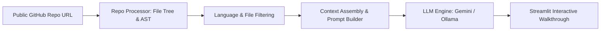

<p align="center">
  
</p>

<p align="center">
     
</p>


## 📌 Table of Contents
- [📖 Executive Summary](#-executive-summary)
- [✨ Key Features & Capabilities](#-key-features--capabilities)
- [🏗️ System Architecture & Workflow](#️-system-architecture--workflow)
- [🛠️ Tech Stack Breakdown](#️-tech-stack-breakdown)
- [⚙️ Reproducible Quickstart & Setup](#️-reproducible-quickstart--setup)
- [📂 Project Directory Layout](#-project-directory-layout)
- [👩‍💻 Author & Contributions](#-author--contributions)

---

## 📖 Executive Summary
### Problem Statement
Exploring unfamiliar open-source GitHub repositories is intimidating for students and junior developers due to fragmented documentation, undocumented functions, and complex folder structures.

### Motivation & Solution Overview
GitHub Codebase Explainer is a full-stack GenAI web application that parses public GitHub repositories, extracts Abstract Syntax Trees (AST) and directory structures, and leverages LLMs (Google Gemini API / Ollama) to synthesize beginner-friendly codebase walkthroughs.

---

## ✨ Key Features & Capabilities
- **Repository Ingestion:** Ingests any public GitHub repository URL and extracts file hierarchies.
- **AST Code Parsing:** Inspects classes, functions, and import graphs using Python's native `ast` module.
- **Dual LLM Support:** Seamlessly switches between cloud LLMs (Google Gemini 1.5/2.0) and local offline LLMs (Ollama).
- **Beginner-Friendly Summaries:** Formats technical breakdowns with analogies, architectural workflows, and setup tips.

---

## 🏗️ System Architecture & Workflow


---

## 🛠️ Tech Stack Breakdown
| Component | Technologies |
|---|---|
| **Web Interface** | Streamlit |
| **Language & Parsing** | Python 3.10+, AST (Abstract Syntax Tree) |
| **AI Models** | Google Gemini API, Ollama (Local Models) |
| **API Integration** | Google GenAI SDK, Requests, GitPython |

---

## ⚙️ Reproducible Quickstart & Setup
### Prerequisites
- Python 3.10+
- Google Gemini API key (optional for cloud mode) or Ollama (for local mode)

### Setup Steps
```bash
git clone https://github.com/Bhumikaravi/github-code-explainers.git
cd github-code-explainers

python -m venv .venv
# Windows:
.venv\Scripts\activate
# Linux/macOS:
source .venv/bin/activate

pip install -r requirements.txt
cp .env.example .env

streamlit run backend/main.py
```

---

## 📂 Project Directory Layout
```text
github-code-explainers/
├── .env.example
├── .gitignore
├── requirements.txt
├── README.md
├── .streamlit/
│   └── config.toml
└── backend/
    ├── github_processor.py
    ├── llm.py
    └── main.py
```

---

## 👩‍💻 Author & Contributions
Developed by **Bhumika Ravi** ([@Bhumikaravi](https://github.com/Bhumikaravi)), Bachelor of Computer Applications (BCA) at **Alliance University, Bengaluru**.

- 💻 **GitHub Profile:** [github.com/Bhumikaravi](https://github.com/Bhumikaravi)
- 🔗 **LinkedIn:** [linkedin.com/in/bhumika-ravi-b5a01b326](https://www.linkedin.com/in/bhumika-ravi-b5a01b326/)
- 📬 **Email Contact:** [bhumikaravi2006@gmail.com](mailto:bhumikaravi2006@gmail.com)

---

<p align="center">
  
</p>
